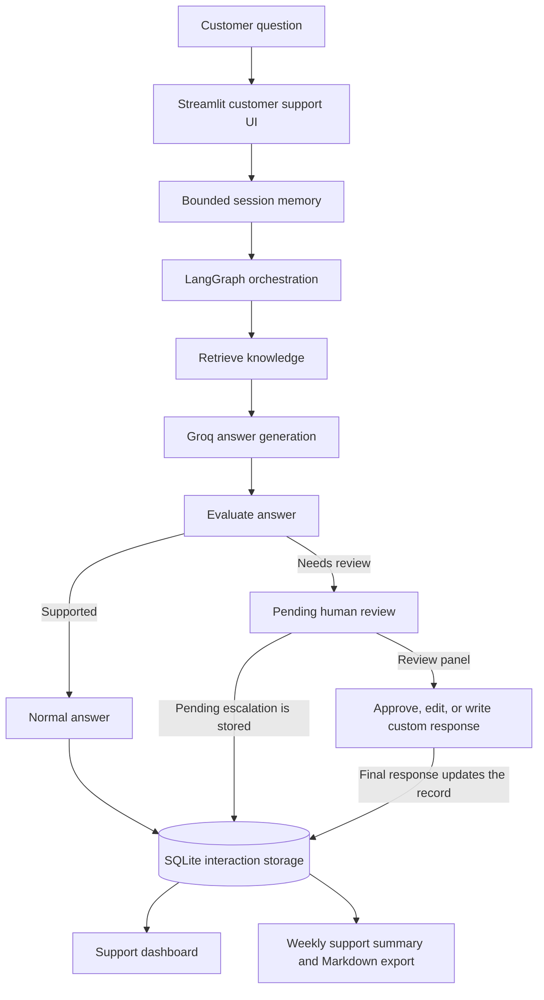

# TechNest Local Business Customer Support Bot

## 1. Project Overview

TechNest is a fictional electronics retailer. This college project is an Agentic AI customer-support system that answers questions using a business knowledge base, retrieves relevant information with RAG, and uses Groq for natural-language responses. LangGraph orchestrates retrieval, answer generation, and response evaluation. Ambiguous questions, unsupported responses, and policy-exception requests can be routed to a simulated human-support review.

The app also maintains bounded session memory, persists support interactions in SQLite, and provides a support dashboard with a weekly summary.

**TechNest and all business and customer data in this project are fictional examples created for a college project.** Do not use the sample policies as real business guidance.

## 2. Key Features

- RAG over the store FAQ, return policy, and product catalogue
- Product catalogue search, including product details and prices
- Groq responses grounded in retrieved TechNest context
- Source filenames and retrieved passages displayed in the chat
- LangGraph orchestration for retrieval, generation, evaluation, and escalation
- Deterministic checks that route insufficient or unsupported answers for review
- Simulated human-in-the-loop review for escalated cases
- Human actions to approve, edit and approve, or reject and write a custom response
- Bounded session memory for follow-up questions
- Persistent SQLite storage of individual support interactions
- Support dashboard with interaction, escalation, topic, and trend analytics
- Weekly support summary with Markdown export

## 3. Architecture



The Streamlit interface receives the customer question and keeps recent messages in the current session. LangGraph coordinates retrieval and generation, then evaluates whether the answer appears supported. A normal response is returned to the customer; an escalated response waits for an explicit choice in the simulated support-review panel. Interactions and their source/escalation metadata are stored in SQLite. The dashboard and weekly summary calculate aggregate views from those stored records.

## 4. Agentic Design Patterns

### Evaluator with Conditional Routing

The `evaluate_answer` node in `src/graph.py` checks for retrieval or generation errors, insufficient context, policy-exception requests, and answers that fail the project's grounding heuristics. `route_after_evaluation` and the graph's conditional edge send supported cases to normal completion and cases needing review to the escalation node. This evaluation is a safeguard based on the implemented heuristics; it does **not** guarantee factual correctness.

### Human-in-the-Loop

The graph marks escalated cases as pending. `app.py` displays the review panel, while `src/hitl.py` validates explicit human choices:

- **Approve:** use the generated answer.
- **Edit & Approve:** use the human-edited answer.
- **Reject & Write Custom Response:** use a new response written by the reviewer.

The customer receives the final reviewed response. This is a local demo flow, not a connection to a real support team.

## 5. RAG Pipeline

1. `src/retrieval.py` loads `data/faq.md`, `data/return_policy.md`, and `data/products.csv`.
2. Markdown is split into heading-aware text chunks. Headings and source filenames are retained.
3. Each product CSV row becomes a searchable record containing its product details and `products.csv` source label.
4. Scikit-learn's TF-IDF vectorizer converts document text and the customer query into weighted term vectors.
5. Cosine similarity ranks relevant records. The graph requests up to three relevant chunks for a question; broad catalogue requests can return the product list.
6. The retrieved text and source labels are passed to the Groq service along with bounded recent conversation context. The model is instructed to answer from the supplied TechNest knowledge.
7. Retrieved sources are shown in a collapsible **Sources used** section in the chat.

## 6. Project Structure

```text
.env                         Local Groq API key; do not commit
.env.example                 Safe environment-variable template
.gitignore                   Ignores local secrets, virtual environments, caches, and databases
README.md                    Project documentation
app.py                       Streamlit chatbot, HITL panel, navigation, and dashboard
requirements.txt             Direct Python dependencies

data/
  faq.md                     Fictional store and service information
  products.csv               Fictional product catalogue
  return_policy.md           Fictional return-policy examples

src/
  __init__.py                Marks src as a Python package
  database.py                SQLite setup and parameterized persistence/read queries
  graph.py                   LangGraph nodes, conditional routing, and graph entry point
  hitl.py                    Human-decision validation and final-response state
  llm_service.py             Groq prompt construction, API calls, and safe error handling
  memory.py                  Bounded in-session conversation context helpers
  retrieval.py               Knowledge loading, chunking, TF-IDF, and cosine retrieval
  state.py                   Typed state shared by LangGraph nodes
  summarizer.py              Dashboard analytics and deterministic weekly report generation

tests/
  test_dashboard_app.py      Headless Streamlit navigation/dashboard smoke test
  test_database.py           SQLite persistence tests using temporary databases
  test_graph.py               Graph workflow, routing, and contextual retrieval tests
  test_hitl.py                Human-review decision tests
  test_llm_service.py         Prompt and Groq error-handling tests using a fake client
  test_memory.py              Session-memory and context-limit tests
  test_retrieval.py           Knowledge loading and retrieval tests
  test_summarizer.py          Analytics, weekly-summary, and export tests
```

## 7. Requirements

The direct project dependencies are:

- `streamlit`
- `scikit-learn`
- `groq`
- `python-dotenv`
- `langgraph`

SQLite (`sqlite3`) and `unittest` are included in Python's standard library. The project currently requires Python 3.10 or newer. Dependency versions are not pinned.

## 8. Windows Setup

Open PowerShell in the project folder and create/activate a virtual environment:

```powershell
python -m venv .venv
.\.venv\Scripts\Activate.ps1
python -m pip install --upgrade pip
pip install -r requirements.txt
```

Create a local `.env` file from the example if one does not already exist:

```powershell
if (-not (Test-Path .env)) { Copy-Item .env.example .env }
notepad .env
```

Set the key in `.env` using this format:

```text
GROQ_API_KEY=your_key_here
```

Replace `your_key_here` with your own Groq API key. **Never commit `.env` or share its contents.** The `.gitignore` file excludes it. Keep `.env.example` free of real credentials.

## 9. Run the Application

With the virtual environment activated, run:

```powershell
python -m streamlit run app.py
```

Open the local URL printed by Streamlit in the terminal (normally `http://localhost:8501`). Use the sidebar navigation to switch between **Customer Support** and **Support Dashboard**.

## 10. Run Tests

With the virtual environment activated, run:

```powershell
python -m unittest discover -s tests -v
```

## 11. Customer Support Flow

Example product question:

> Customer asks: “What is the price of the keyboard?”

The retriever finds the matching product record, Groq writes a response using the retrieved context, the UI displays its source, and the interaction is stored in SQLite.

Example escalation question:

> “I want a refund even though my product is outside the return period. Can you make an exception?”

The system retrieves relevant return-policy information, generates and evaluates a draft, and routes the case for simulated human review if an exception is requested. The reviewer can approve, edit and approve, or reject the draft and write a custom response. The final response and escalation status are saved to SQLite.

## 12. Support Dashboard

The dashboard reads the existing SQLite database and shows total support interactions, escalated and non-escalated counts, escalation rate, topic categories, common escalation reasons, and daily trends for the recent seven-day period. The weekly summary reports aggregate metrics, topics, reasons, observations, and recommendations, with a Markdown download option.

The database stores **individual question/answer turns**. Dashboard interaction counts therefore count turns, not unique chats or sessions. The weekly period is today and the previous six calendar days. Topic labels are assigned using lightweight keyword rules.

## 13. Security

- The Groq API key is read from the local `.env` file through the environment; it is not intended to be stored in source code.
- `.env` is listed in `.gitignore`; `.env.example` contains a placeholder only.
- SQLite statements that use values are parameterized.
- Groq errors are translated into safe messages rather than displaying raw SDK errors that could contain request details.
- The store, policies, products, and example interactions are fictional project data.

## 14. Limitations

- The evaluator uses deterministic heuristics. It is a safeguard, not a formal guarantee that every response is correct or supported.
- Topic classification uses keyword rules and may assign ambiguous questions to an imperfect category.
- The support dashboard has no authentication and is intended for local or college-demo use.
- Dependencies are unpinned, so fresh installations may resolve different versions over time.
- The project uses fictional business and customer data and is not production support software.

## 15. Testing Notes

The latest verified full test run before this README-only update reported:

```text
Ran 48 tests
OK
```

Tests were **not rerun** while editing this documentation.

## 16. Future Improvements

- Use stronger semantic evaluation for answer support.
- Explore a vector database for larger knowledge bases.
- Add authentication before exposing support analytics beyond a local demo.
- Consider a production database for deployed use.
- Improve topic classification beyond simple keyword rules.
- Make reporting-timezone behavior explicit and timezone-aware.
- Pin dependency versions for reproducible setup.
